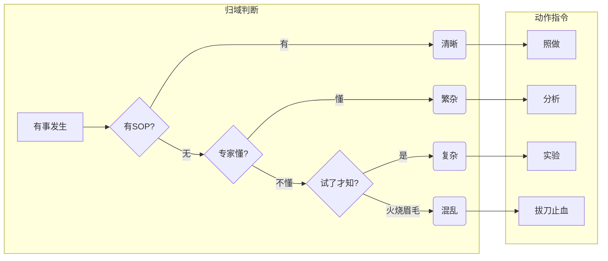
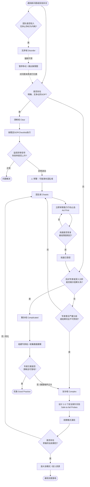

---
素材:
  - 知识
---

# 知境善策：Cynefin框架导论

## 楔子

世间万事，其理各异，其法不同。治国理政如此，企业经营亦然，即便是求学问道中的一介书生，面对课业选择、社团纷争、未来规划，亦常感困惑：为何某种情境下行之有效的策略，换一处便全然失灵？为何有些问题条理分明，有些却如一团乱麻，剪不断理还乱？此问不唯关乎方法之选择，更关乎对问题本身性质之判断。倘无此判断，则一切决策皆如盲人摸象，虽殚精竭虑，终难得其要领。

然则，可有框架以助吾人明辨诸般情境之性质，进而择其相宜之应对策略乎？此问引出一名曰Cynefin之思想体系。此名源于威尔士语，其音若“卡内文”，意谓“栖息之所”或“归属之地”，暗含一种对所处环境多重面向的感知与理解。此一框架，便是一幅认知的地图，旨在帮助人们辨明其所处的情境类型，从而避免以刻舟求剑之法应对千变万化之事。

## 第一章 五域之辨：Cynefin框架的根基

欲明Cynefin之妙用，首当知其分类。此框架将问题情境分为五个领域，各具特质，各有其内在逻辑与应对之道。此五域者，曰清晰，曰繁杂，曰复杂，曰混沌   a    ，曰失序。前四者如四方之域，各据一隅，后者则为中央之渊，是判断失据的困顿之所。

### 清晰之域

清晰之域，又称简单域或显而易见之域。在此域中，因果之间的关系昭然若揭，人人可见。譬如烤制一块蛋糕，若遵循既定配方，则结果必然可期。此域的特征是“已知的已知”——不仅问题的答案已知，甚至问题可能出现的种种变数亦尽在掌握。在此间运作，规矩既定，最佳实践已成，只需感知情境，对情境进行分类，进而依规响应即可。

然此域暗藏一陷阱：因其过于明晰，管理者易生懈怠，将稳定误认为永恒，忽视了清晰之域往往是从其他领域通过努力方才获得的成果，而非天赐的常态。

### 繁杂之域

繁杂之域中，因果关系虽存，却非一目了然，需要专家分析方能揭示。譬如将一枚火箭送入太空，其中涉及的物理学原理是确定的，但非寻常人所能通晓。此域的特征是“已知的未知”——问题有正确答案，但需要专门知识和深入分析方能寻得。在此间，应对之道是感知情境，进行分析，然后做出响应。所谓“专家”与“诊断”，正是此域的核心。

繁杂之域与清晰之域的区别在于：前者需要判断，后者只需遵从；前者可能存在多个正确答案，后者通常只有一个最优解。

### 复杂之域

此乃Cynefin框架最具洞见之处。复杂之域中，因果关系并非固定不变，而是相互纠缠，互为前提，只能在事后追溯其迹，却无法预先推演其果。譬如养育一个孩子，某种教育方式会产生何种结果？即便翻阅无数案例，也无法确知。此域的特征是“未知的未知”——问题本身在变化，答案亦随情境流转。在此间，不能“分析—规划—执行”，而须“探测—感知—响应”。先行动试探，观察后果，从中学习，再调整后续行动。这便是“试错”与“涌现”的领地。

复杂之域与繁杂之域的根本差异在于：前者如同一个花园，园丁可以播种浇水，却无法命令种子何时发芽；后者如同一台钟表，拆开每个齿轮便可理解其运作。

### 混沌之域

混沌之域中，因果关系无从捉摸，系统处于剧烈动荡之中，任何寻求规律的努力皆为徒劳。譬如地震突发之时，一切预案皆可能失效。此域的特征是“不可知”——此时需要的不是分析，而是立即行动以稳定局面，建立秩序，将混沌转化为其他可管理的领域。应对之法为“行动—感知—响应”：先行动止血，再观察变化，进而调整策略。

### 失序之域

失序并非一个独立的情境类型，而是一种元状态——即无法判断自己身处上述四域中的哪一个。此时，人们往往倾向于将其归为自己最熟悉或最偏好的领域，从而做出错误决策。失序之域的首要任务，是分裂它，迫使自己分辨出情境的真实性质，进入其他四个领域之一。

## 第二章 源流与比较：Cynefin的思想谱系

Cynefin框架由威尔士学者戴夫·斯诺登于1999年前后提出，其思想根基可追溯至知识管理与复杂科学两大源流。斯诺登长期任职于IBM环球服务部门，在从事知识管理实践中，深感传统决策模型——如线性规划、最佳实践复制、标准化流程——在面对复杂组织问题时的无力。他借鉴了复杂适应系统理论、混沌理论与认知科学，试图构建一个既尊重人类认知局限，又不否认世界客观复杂性的决策框架。

若将Cynefin与其他决策框架相较，其独特性便愈发彰显。譬如广为流传的PDCA循环（计划—执行—检查—改进），其隐含假设是问题可以被清晰界定，因果链条可以被完整追溯——这仅在清晰域与繁杂域中有效，在复杂域与混沌域中则可能沦为精致的谬误。又如传统的风险评估矩阵，其逻辑是已知风险的概率与影响可以量化——这预设了“已知的未知”，却无法处理复杂域中“未知的未知”。

Cynefin与情景规划、黑天鹅理论、韧性思维等当代思想流派有着深刻的亲缘关系。情景规划承认未来有多种可能，但其方法论仍倾向于在繁杂域中运作——通过分析驱动推测；而Cynefin则更进一步，指出在某些情境下，未来的可能性本身是涌现的，无法穷举。黑天鹅理论关注罕见而影响巨大的事件，Cynefin则将这类事件定位于混沌域与复杂域的边界地带。韧性思维强调系统在冲击后的恢复与重组能力，这与Cynefin在复杂域中倡导的“探测—感知—响应”逻辑高度一致。

## 第三章 价值与局限：Cynefin的实践省思

Cynefin框架之价值，首要在于破除一种根深蒂固的迷思——即所有问题都可以用同一种方法解决。现代管理教育常倾向于传授“最佳实践”，仿佛世间问题皆可标准化、流程化、工具化。Cynefin以其清晰的分类警示吾人：将复杂问题当作繁杂问题处理，会导致过度简化与虚假确定；将繁杂问题当作清晰问题处理，则可能忽视关键的专家知识；将任何问题当作混沌问题处理，则会陷入无谓的恐慌与莽撞行动。

此框架的第二个价值，在于提供了一个共同的语言，使团队得以讨论“我们究竟面对何种类型的问题”。在许多组织中，分歧往往并非源于目标差异，而源于对问题性质的判断不同。一方认为情境清晰可控，另一方觉察到潜在的复杂与混沌，于是争论陷入“你太僵化”与“你太鲁莽”的相互指责。Cynefin提供了一面镜子，让这些隐含假设浮现出来，成为可讨论的对象。

然而，Cynefin亦非无懈可击。批评者指出，其分类并非泾渭分明，边界常常模糊。一个情境可能同时具有复杂域与繁杂域的特征，如何判断孰为主导？斯诺登本人承认此点，并提出“边界管理”的概念——即在不同领域交界处，需要特别审慎的观察与判断。此外，Cynefin本质上是一个认知辅助工具，而非精确的诊断仪器；其有效性依赖于使用者的判断力，若使用者本身认知偏误严重，则框架亦难补救。

另一个争议在于：Cynefin是否过于静态？现实中的问题往往在不同领域之间流转。一次成功的危机干预（混沌域）可能将局面转化为复杂域，而持续的有效管理又可能将复杂域转变为繁杂域，最终固化为清晰域。但若过度自信，清晰域也可能在意外冲击下瞬间滑入混沌域。Cynefin框架本身并非不能描述这种流转——事实上，这正是其核心洞见之一——但实践中，使用者往往倾向于将问题“钉”在某一个领域，而忽视了情境的动态演变。

## 第四章 未来之道：Cynefin的拓展与新生

进入人工智能与大数据时代，Cynefin框架面临新的挑战与机遇。一方面，机器学习算法在某些繁杂域中已展现出超越人类专家的能力，这使得“繁杂”与“清晰”之间的界限进一步模糊——当算法可以在毫秒之间完成过去需要专家团队数月分析的诊断工作时，原本属于繁杂域的问题是否应降维至清晰域？另一方面，人工智能在复杂域中的表现仍相当有限——因为复杂域的核心是涌现与不可预测，而这恰恰是当前数据驱动模型的短板。这提示我们：人工智能并非万能钥匙，其适用边界恰好可以用Cynefin框架来界定。

新的问题随之浮现：在算法日益渗透决策过程的时代，Cynefin框架本身是否需要演进？斯诺登及其合作者近年来提出了“复杂自适应系统”框架的升级版本，将多重时间尺度、社会物质性、叙事与记忆等因素纳入考量。未来的发展可能朝向两个方向：一是与网络科学、系统动力学等定量方法结合，尝试为领域边界提供可观测的指标；二是与行为经济学、认知心理学更深度融合，探究人们为何总是倾向于将问题归入自己偏好的领域——这既是一个认知问题，也是一个权力与组织文化的问题。

对于当代大学生而言，Cynefin框架的价值尤在于提供一种思维习惯：在面对任何问题时，首先问自己——“我面对的是何种性质的情境？”若是一道期末考试题，答案明确，步骤清晰，那便是清晰域，尽可依规作答。若是一项研究课题，需要查阅文献、设计实验、分析数据，那便是繁杂域，需要调用专业知识。若是组织一场学生活动，涉及多方协调与不确定的外部环境，那便是复杂域，只能先行动、再感知、后调整。若是突发危机——譬如活动当天场地被临时取消——那便是混沌域，首要任务是止血稳定，而非追责分析。

知境者智，善策者明。Cynefin框架并非一劳永逸的答案，而是一条提问的道路。它提醒我们：世界比我们想象的要丰富，也远比我们愿意承认的要复杂。真正的智慧不在于掌握一种万能方法，而在于知道什么时候该用什么样的方法，以及——同样重要的——知道什么时候该承认自己不知道。

## 扩展阅读

若读者欲深入探索Cynefin框架及其背后的思想脉络，以下著作堪为指引：

1. Snowden, D. J., & Boone, M. E. (2007). “A Leader’s Framework for Decision Making.” *Harvard Business Review*, 85(11), 68-76. —— 此为Cynefin框架最经典的入门文献，行文清晰，案例丰富。

2. Kurtz, C. F., & Snowden, D. J. (2003). “The New Dynamics of Strategy: Sense-making in a Complex and Complicated World.” *IBM Systems Journal*, 42(3), 462-483. —— 更为学术化的原始论文，详述框架的理论根基。

3. 斯诺登本人主理的“Cognitive Edge”网站（cognitive-edge.com）提供了大量案例研究、方法工具与社区讨论，是跟踪框架演进的最前沿阵地。

4. 关于复杂适应系统的基础理解，可参阅：Holland, J. H. (1995). *Hidden Order: How Adaptation Builds Complexity*. Addison-Wesley. 以及 Waldrop, M. M. (1992). *Complexity: The Emerging Science at the Edge of Order and Chaos*. Simon & Schuster.

5. 对于决策认知偏误的深入探讨，丹尼尔·卡尼曼的《思考，快与慢》（Kahneman, D. (2011). *Thinking, Fast and Slow*. Farrar, Straus and Giroux）是极佳的伴侣读物，其“系统一”与“系统二”的划分与Cynefin的领域分类有着深刻的互补关系。

愿诸君在认知的地图上，既能明辨四方，亦能安处失序之渊，最终抵达一种更为谦逊而有力的实践智慧。

## 实操步骤
要将 Cynefin 框架从认知概念转化为日常决策武器，关键在于建立一套**强制性的前置诊断流程**。

许多人在实际中失败，是因为他们直接凭直觉跳入“应对方案”，而跳过了“判断它属于哪个域”这一环。以下是经过验证的**三步落地实操法**。

### 第一步：强制归类诊断（解决“无序”内耗）

在启动任何项目会议或处理棘手问题时，**先禁止讨论具体解决方案**。用下面三个问题引导团队快速投票，将问题锚定在图上。

| 诊断问题 | 如果回答是... | 如果回答否... | 定位逻辑 |
| :--- | :--- | :--- | :--- |
| **1. 这个问题以前出现过吗？且有明确的、无争议的处理SOP？** | **清晰域** | 进入下一问 | 找现成的规则 |
| **2. 虽然没现成答案，但找对这个领域的专家（或拆解分析）能搞明白吗？** | **繁杂域** | 进入下一问 | 找外脑/做分析 |
| **3. 专家意见分歧巨大？或者只有做了才知道结果对不对？** | **复杂域** | **混乱域** | 无法预测，只能试探 |

### 第二步：分域执行卡（照着做，不越界）

一旦定好位置，**必须强制使用该域独有的“语法”和“工具”**，严禁跨域挪用手段。

#### 🟢 清晰域 · 执行卡
- **动作口诀**：**别想，照做。**
- **关键工具**：Checklist（检查表）、SOP手册、自动化脚本。
- **管理者禁语**：“我觉得这里可以优化一下流程。”（只要环境没变，不要优化，优化就是浪费资源）。
- **唯一风险监控**：**盯着“微弱异常信号”**。如果发现 SOP 失败率从 0.1% 升到 1%，立刻拉响警报——**悬崖就在脚下**。

#### 🟡 繁杂域 · 执行卡
- **动作口诀**：**感知 → 分析 → 响应。**
- **关键工具**：鱼骨图、专家访谈、竞品分析报告、数据建模。
- **管理者禁语**：“我们先用最小可行产品（MVP）试一下。”（这是复杂域的招数，在这里纯属浪费时间和预算，因为专家能算出来最优解）。
- **落地案例**：要选择新的ERP系统供应商。**不要试错**，而是花两周时间做详细的**需求规格说明书**和**供应商尽职调查**。

#### 🔴 复杂域 · 执行卡
- **动作口诀**：**探测 → 感知 → 响应。**
- **关键工具**：**探针实验**（Safe-to-fail Probes）、A/B测试、故事收集。
- **管理者禁语**：“谁能给我一个确切的投入产出比（ROI）再立项？”（没人能给，能算出来的都不是复杂问题）。
- **实操技巧——平行探针法**：
    - 针对一个复杂问题（如提高员工敬业度），**同时**启动 3 个极低成本、互不干扰的小实验：
        - 实验A：周五四点下班。
        - 实验B：CEO每天随机给一名基层员工写感谢便签。
        - 实验C：取消所有形式主义周报。
    - **观察 2 周**，看哪个实验周围出现了**自发模仿或正向传言**（涌现）。**放大那个涌现的模式，放弃没动静的。**

#### ⚫️ 混乱域 · 执行卡
- **动作口诀**：**行动 → 感知 → 响应。**
- **关键工具**：紧急制动开关、独裁授权、危机公关红头文件。
- **管理者禁语**：“我们先把所有涉事人员拉个群开个线上分析会吧。”（这是作死行为）。
- **行动参考标准**：
    1. **第一动作必须是切断/阻断**（拔网线、撤热搜、停产线、冻结账户）。
    2. **第一句话必须是不解释只承诺**（“我们正在全力恢复，将在XX点更新进展”，而不是“这是由于数据中心路由策略变更导致的……”）。

---

### 第三步：跨域边界巡逻（防止“清晰域幻觉”）

在实际工作中，最致命的应用盲区是**认为自己还在清晰域，其实已经掉进了混乱域**。

**边界预警信号表（贴在办公桌前）**

| 你在... | 当你听到以下台词时... | 说明你已滑向... | 立即纠偏动作 |
| :--- | :--- | :--- | :--- |
| 清晰域 | “奇怪，最近怎么老是要**特批**啊？” | **繁杂域** | 别硬套SOP了，快找专家把新情况写进新规则。 |
| 繁杂域 | “这个数据分析做了3版了，老板怎么都不满意？” | **复杂域** | 别算了，数据噪声太大。去做个小范围试点吧。 |
| 复杂域 | “现在局面已经完全失控了，客户在砸店！” | **混乱域** | **别研究了！先叫保安把门关上！** |

### 附：实际应用自检清单（开每日站会用）

- [ ] 我今天要处理的三件事，分别画在哪四个域里？
- [ ] 有没有一件事，我想用**清晰域**的手段（催、要求流程）去解决一个**复杂域**的问题（比如下属的主动性、团队默契）？
- [ ] 有没有哪件事出现了**意料之外的副作用**？——这可能是从清晰域滑向悬崖的信号。
- [ ] 团队里现在有没有人因为意见不合而陷入**无序**争吵？如果是，先停下来画象限图，而不是投票表决方案。

### 总结：一句话心法
**清晰的事靠流程，繁杂的事靠专家，复杂的事做实验，混乱的事先拔刀，不知道什么事的时候——先画图。**

