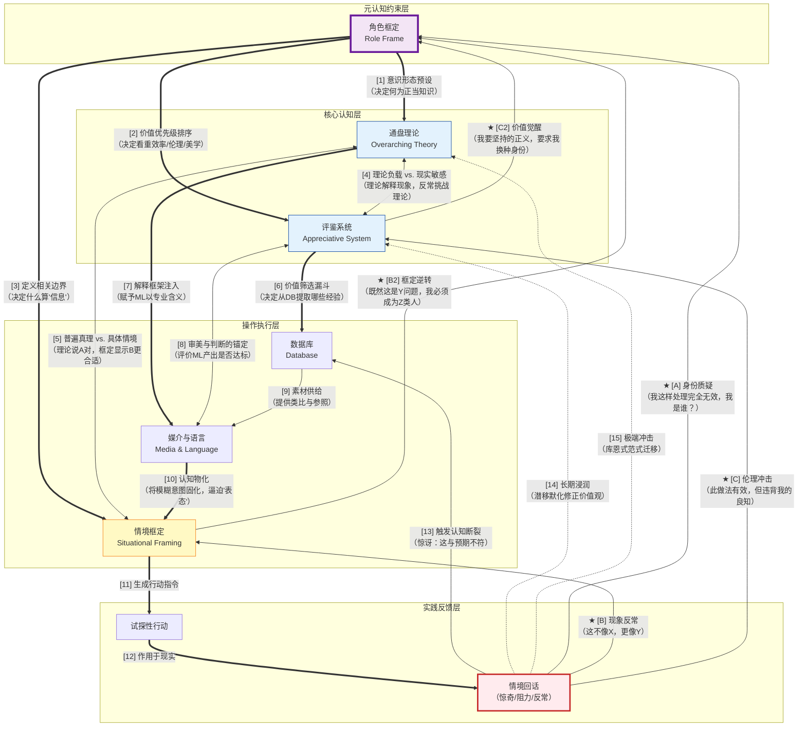

# 实践中生成的知识：深度解析唐纳德·舍恩的“反映性实践”

## 1. 基本理解：什么是反映性实践？

### 1.1 核心概念与定义

**反映性实践**（Reflective Practice）是美国麻省理工学院教授唐纳德·舍恩在其1983年出版的经典著作《反映的实践者：专业工作者如何在行动中思考》中提出的核心概念。舍恩的论述始于对一个基本现象的观察：**专业工作者在面对真实世界的问题时，并不是单纯地应用已有的理论和技术，而是在行动的过程中、在与问题情境的不断对话中，即时地反映、学习并生成新的知识和行动策略。** 他将这种能力称为“行动中反映”（Reflection-in-Action）。

这个定义需要从以下几个层次来理解：

- **否定“技术理性”的垄断地位**：舍恩将自19世纪以来支配专业教育的主导认识论称为**技术理性**（Technical Rationality）。其核心逻辑为：专业的实践是运用科学理论和技术去解决清晰界定的问题。在这个模型中，先有知识（在大学和研究机构中生产），后有应用（从业者在实践中执行）。舍恩的基本论断是：技术理性只能解释专业实践中一小部分的工作——那些可以被清晰界定为结构良好问题的情境；而在那些模糊、混乱、充满了不确定性和价值冲突的情境中，真正富有经验的专业工作者所作的，远非单纯应用已知规则——他们在行动中反映，在行动中学习，在行动中重塑对问题的理解和对解决路径的构想。

- **行动中反映**：这不是在行动结束后的回顾（舍恩称后者为“对行动的反映”），而是**在行动进行的同时，你的思维与你的行动在实时地对话**。你尝试某个操作，观察它的效果，感觉到某种“不对劲”，调整操作的方式，再尝试，再观察。你的思维在这个过程中不是暂停行动来思考，而是嵌在行动流之中。

- **与情境的反映性对话**：舍恩将实践者的行动描述为与问题情境的“对话”。实践者对一个情境施加某种操作（一个设计草图、一个提问、一个试探性的干预），情境“回应”给他一些新的信息（意料之外的效果、未曾注意到的特征、新的约束条件），他根据这个回应调整自己的理解和下一步操作。这种“对话”是动态的、即时的、不可完全预演的。

- **实践认识论**：舍恩的核心学术目标是构建一种新的认识论——一种不同于实证主义科学认识论的、内在于实践行动之中的知识的理论。这种知识不是“知道什么”的陈述性知识，也不是“知道如何”的程序性知识，而是**“知道如何在行动中应对不确定性”的知识**——舍恩称之为“行动中的知识”（Knowing-in-Action）。

### 1.2 “行动中反映”与“对行动的反映”的精细区分

舍恩作出了一个至关重要的区分：

|          | 行动中反映                         | 对行动的反映                                    |
| -------- | ----------------------------- | ----------------------------------------- |
| **时间点**  | 在行动进行的同时                      | 在行动完成之后                                   |
| **认知状态** | 嵌在行动流中，不中断行动。思考与行动同步发生        | 暂停或结束行动，后退一步审视已经发生的事情                     |
| **目的**   | 调整正在进行的行动——改善当前情境中的即时表现       | 从经验中提炼教训，修正自身的知识库、框架和行为模式，为未来类似情境做准备      |
| **典型场景** | 治疗师在会话中感觉到患者突然沉默，即时调整接下来的提问方式 | 治疗师在一天的工作结束后，回顾某一次会谈的录音，分析其中的关键节点和自己的应对模式 |
| **认知特征** | 快速、直觉性、依赖于即时感知和模式匹配           | 缓慢、分析性、依赖于对已发生事件的结构化分析                    |

这个区分的重要性在于：专业教育传统上几乎完全关注“对行动的反映”——督导、案例分析、事后复盘——而完全忽略了“行动中反映”的存在及其可训练性。舍恩的工作重点，正是将“行动中反映”从“个人的隐性天赋”带入可分析、可培养的公共知识领域。

### 1.3 为何需要反映性实践？

舍恩的理论建构始于对“专业危机”的诊断。在20世纪下半叶，公众对医学、法律、工程、管理等传统专业的信任不断下降。专业工作者在面对复杂的、充满不确定性的社会问题时，常常表现得如同“技术理性的执行者”而非“明智的判断者”——他们用标准化的技术去解决非标准化的问题，结果往往令人失望。

舍恩的诊断是：这场危机的认识论根源，在于专业教育系统性地压制了实践者自身的行动中反映能力。大学教育将“理论知识”置于“实践知识”之上，将从业者训练为已有理论的执行者，而非情境中的探索者。当一个年轻的专业工作者在课堂上学会了标准化的操作流程，然后在工作中第一次面对一个不完全符合任何教科书案例的复杂情境时，他所受的训练并没有教他如何在这种情况下进行有效的行动中反映。他的技术理性告诉他“应该有一个正确答案”，而现实的情境告诉他“所有现成的答案都不完全适用”。这种认识论的困境，正是专业危机中“专业人士无能的愤怒”和“公众对专业的不信任”的共同来源。

因此，舍恩提出的反映性实践，不仅是对一种思维方式的描述，也是对专业教育和专业实践的规范性重塑——他试图论证：**真正的专业能力，不是储存了多少已有知识，而是在面对独一无二的不确定情境时，能够在行动中生成新知识的能力。**

## 2. 核心框架：反映性实践的运作机制

### 2.1 行动中知识的三个层次

舍恩将专业工作者在行动中调用的知识分为三个层次：

**第一层：知道-在-行动中（Knowing-in-Action）。** 这是专业工作者在其熟练领域中执行操作时所展现的隐性知识——那些不需要思考就能完成的操作。一个熟练的钢琴家不需要思考手指应该放在哪个琴键上；一个经验丰富的医生在听诊时不需要重新学习如何识别心音。这种知识是在长期实践中内化到身体和直觉之中的，行动者通常无法用语言完全描述自己是如何做到的。

**第二层：行动中反映（Reflection-in-Action）。** 当知道-在-行动遭遇了意外——当你预期会发生的事情没有发生，或者发生了你未曾预料的事情——你进入行动中反映。它不是停下来推理，而是你在继续行动的同时，你对情境的理解被重构了。舍恩描述说，这种反映通常发生在行动流畅性的某种“断裂”之中——一个意料之外的反馈、一个不协调的感觉、一个微妙的不对劲——它在不中断行动的前提下，触发了对行动框架本身的即时调整。

**第三层：对行动的反映（Reflection-on-Action）。** 在行动结束后，实践者跳出行动流，以“事后回顾”的方式审视已经发生过的事情。这是专业教育中最被重视的反映形式——案例分析、督导讨论、事后复盘——但它本质上是回溯性的，不直接作用于正在进行的行动。

舍恩的理论重点落在**第二层**。他指出，“知道-在-行动”与“行动中反映”之间的切换，是专业能力的核心标志。新手只能执行知道-在-行动（当他们熟练掌握的部分）或陷入困惑的停滞（当遭遇意外时）。专家则能在遭遇意外时进入行动中反映——不中断行动，而在行动中重新框定问题并生成新的应对策略。

### 2.2 与情境的反映性对话

舍恩使用“对话”这个隐喻来精确描述反映性实践的动态过程。这并非一个诗意的比喻，而是一个具有认知内涵的技术性概念。实践者对一个情境做出一个“发言”——一个设计草图、一个诊断假设、一个试探性的提问或干预。情境对这个发言做出“回应”——反馈出意料之外的后果、显露之前未被注意到的新特征、表达出新的约束或可能性。实践者接收这个回应，修正或重构对情境的理解，并做出下一个“发言”。

这个过程的核心特征是：情境的回应总是在某种程度上是**意外的**——如果完全在预期之内，就不需要反映性对话，只需要执行既定操作即可。正是这种意外的回应，触发了实践者的“行动中反映”，迫使他对自己的理解框架进行调整。实践者在与情境的对话中，并不是发现一个预先存在的“正确答案”，而是在情境的协助下，为自己定义一个问题并构建一个在当前情境下可行的解决方案。

### 2.3 反映性实践的经典案例研究

**建筑设计工作室中的教学对话**
舍恩对建筑教育进行了详细的观察性研究，记录了设计教师与学生之间的对话。一个经典的模式是：学生带着自己设计的草图来到教师面前，呈现了一个初步方案，并解释了为什么这样做。教师看着学生的草图，说：“我看到你在这里做了X。你有没有考虑过在这个位置如果做Y，整个空间的体验会是什么样？”教师在说这句话时，并不是简单地评估学生的方案（那是“对行动的反映”），而是在**示范行动中反映本身**——教师将自己代入学生的设计过程中，在学生的草图上“重新设计”，并向学生展示：一个更有经验的设计者是如何在与草图的即时对话中，产生新的空间想法的。教师的话语为学生提供了一个“行动中反映的现场示范”，学生通过观察教师的即兴设计思考过程，学习如何进行这种对话。

**心理治疗的即兴过程**
舍恩分析了心理治疗中治疗师的反映性实践。一个治疗师在与患者的对话中，对患者说了一句话。患者对此的反应不是治疗师预期的任何一种反应，而是陷入了一种治疗师未曾预料的情绪波动。在这一瞬间，治疗师不得不即时调整他的理解框架——他原本假设这个患者在某个话题上已经准备好进行开放性的探讨，但患者的反应表明这个假设是错误的。治疗师并没有暂停治疗、退出对话去分析这个情况，而是在延续对话的同时，在内心进行了一个快速的行动中反映：他重新框定了患者的状态，调整了自己的回应策略，并在同一段对话中试用了这个新的策略。治疗师的这种能力——在被患者的回应“惊讶”的瞬间，不中断治疗流，而在行动中重构理解并生成新的干预——正是行动中反映的精髓。

### 2.4 反映性实践与技术理性的对比

舍恩通过对比技术理性与反映性实践，为后者划定了清晰的认知边界：

| 维度         | 技术理性                            | 反映性实践                                             |
| ---------- | ------------------------------- | ------------------------------------------------- |
| **知识的性质**  | 普遍的、情境无关的理论与规则                  | 在具体情境中生成的、情境特定的知识                                 |
| **知识的应用**  | 从一般到特殊的演绎：将标准化的知识应用于具体案例        | 在行动中生成新的理解框架：知识产生于实践，而非先于实践                       |
| **问题如何定义** | 问题已经被预先清晰定义，实践者只需要选择适当的理论工具来解决它 | 问题本身是模糊的、待定义的，实践者的首要任务是“框定问题”——而这一框定过程本身就是专业判断的核心 |
| **实践者的角色** | 已有知识的执行者——应用被授权的方法去解决被授权的问题     | 新知识的生成者——在与情境的对话中，不断生成新的理解和新行动策略                  |
| **错误的来源**  | 知识不完备或应用错误——解决方法是补充知识或改进应用流程    | 理解框架不适当——解决方法是重新框定问题，在行动中构建新的框架                   |
| **认识论地位**  | 知识高于实践。先有理论，后有应用                | 实践自身具有认识论地位。实践不依赖既有理论以获得认知合法性                     |

## 3. 与其他概念的关系与辨析

| 对比概念 | 核心差异 | 与反映性实践的关系 |
|----------|----------|---------------------|
| **西蒙的设计思维** | 西蒙将设计视为“问题求解”——在问题空间中进行搜索，利用手段-目的分析寻找满意解 | 舍恩与西蒙构成了关于专业实践本质的两种竞争性理论。西蒙承认设计面对结构不良问题，但他的分析倾向于将设计理性形式化、算法化；舍恩则强调设计知识本质上内嵌于行动中，抗拒完全的形式化。西蒙追问“如何在复杂问题空间中搜索解”，舍恩追问“如何在行动中重新定义问题本身”。这被学术界称为“西蒙-舍恩之争” |
| **罗杰·马丁的整合思维与溯因推理** | 马丁将溯因推理定位为创新思维的核心逻辑，强调在张力中构建新方案 | 马丁的溯因推理描述了“产生新假设”的逻辑形式，舍恩的行动中反映则描述了这一逻辑在真实专业实践中的**动态展开过程**。整合思维者“做什么”，正是舍恩所描述的“与情境进行反映性对话”。马丁提供的是整合思维的结果逻辑，舍恩提供的是其过程描述 |
| **吉尔福特的智力结构** | 将智力分解为180种独立能力的多维模型 | 吉尔福特关注的是“智力的结构”——存在哪些基本能力成分；舍恩关注的是“智力的动态”——能力如何在应对不确定情境时被实时重组和创造性应用。两者在同一时间维度上互补：吉尔福特提供智力的解剖学，舍恩提供智力的生理学 |
| **Nelson & Narens 元认知模型** | 描述元认知的监测与控制循环 | 行动中反映正是对Nelson & Narens“监测-控制”循环在专业实践中实时动态的高精度描述。当实践者的元水平监测到“实际反馈与预期不符”，并即时调整控制指令时，他就在进行行动中反映。舍恩的理论为Nelson & Narens的抽象认知架构，提供了在真实专业情境中运行的详细现象学描述 |
| **模式识别** | 从输入中检测已知模式 | 知道-在-行动高度依赖于熟练的模式识别——专家能“看到”新手看不到的模式。行动中反映之所以发生，正是因为模式识别失败了——当前的输入无法被流畅地匹配到任何已有模式，产生了“惊奇”，从而触发了超越模式识别的创造性反映 |
| **具身认知** | 认知根植于身体的结构与感觉运动经验 | 舍恩强调，知道-在-行动是身体化的知识——木匠的手感、治疗师对语气微妙的感知、设计师手中铅笔的“思考”——这些知识与具身认知的核心主张高度一致：认知不限于大脑，而是分布在脑-身-环境的耦合中 |
| **概念压缩与抽象阶梯** | 将具体经验浓缩为抽象表征 | 专业工作者在长时记忆中储存了大量压缩的经验模式（知道-在-行动的基础）。行动中反映的本质，就是在已有模式无法匹配当前情境时，即时进行一种**新的概念压缩**——将新情境的独特特征压缩为一个新的理解框架。这种压缩不是在事后完成的，而是在行动中实时生成 |
| **认知负荷理论** | 研究工作记忆的容量限制 | 行动中反映是在认知负荷极高的条件下进行的认知操作——你必须同时监测行动的即时效果、检索相关的背景知识、构建新的假设、评估新假设的可行性，而所有这些都在不中断行动的情况下进行。专家的标志之一，就是他们已经将大量的基础操作自动化（降低内在负荷），从而释放出足够的认知资源来支持行动中反映 |
| **涌现理论** | 低层规则在高层产生不可预见的新属性 | 当实践者与情境进行反映性对话时，解决方案不是被“搜索”到的，而是从这种对话中“涌现”出来的 |

## 4. 历史渊源与演变

### 4.1 杜威的反映性思维：舍恩的哲学渊源

舍恩的“反映”概念直接继承了美国实用主义哲学家约翰·杜威的思想。杜威在其1910年出版的《我们如何思维》中，将“反映性思维”定义为：**对任何信念或假设形式的知识，根据其支持基础及其所倾向得出的结论，进行主动、持续而审慎的思考。** 杜威的五阶段反映模型为：感觉到困难→界定问题→提出假设→推论→验证。舍恩继承杜威的核心主张——思维起源于困惑，反映是对困惑的主动探究——但他对杜威做出了一个关键的修正：杜威描述的反映，仍然是一种“停下来思考”的模式，反映与行动在时间上是分开的。舍恩则论证，在专业实践中，最关键的反映并**不暂停行动**——它是一种嵌入在行动流之中的实时认知操作，而非行动之外的回溯性反思。

### 4.2 舍恩的学术轨迹：从组织学习到专业实践

舍恩的学术道路始于对组织学习的研究。他与克里斯·阿吉里斯合作出版了《组织学习》（1978年）和《实践中的理论》（1974年），探讨组织中的人们如何持有“信奉理论”（他们说他们相信的）与“使用理论”（他们实际行为所依据的）之间的差距，以及如何通过反映来缩小这一差距。从组织学习转向专业实践研究，舍恩将他的问题聚焦在个体身上：一个专业工作者在面对独一无二的、不确定的、带有价值冲突的真实情境时，他的头脑和身体是如何运作的？他的答案——反映性实践——既是对组织学习中个体认知基础的深化，也是对专业教育和实践认识论的根本重塑。

### 4.3 《反映的实践者》（1983）及其后续

《反映的实践者》是舍恩最著名的著作。这本书以五个专业的案例研究为核心——建筑设计、心理治疗、管理、工程和城镇规划。舍恩通过对这些领域中专家从业者的实践过程进行细致的观察和访谈，提炼出了反映性实践的理论框架。这一写作方法本身，正是舍恩理论精神的一种展现：不是从理论出发推演从业者应该如何，而是从仔细观察高手从业者的实际行为出发，提炼他们的内在认知结构。1987年，舍恩出版了《培养反映的实践者》，将理论聚焦于专业教育——如何在大学和培训机构中培养行动中反映的能力。

### 4.4 舍恩的遗产：弥散与批评并存

自1980年代以来，反映性实践已渗透进教师教育、社会工作、护理、管理培训等几乎所有实践导向专业的教育标准之中。在英国的许多大学，护理专业学生毕业时需提交“反映性日志”；在哈佛大学，教育学院在培养教师时将反思性讨论作为核心教学方法。但与此同时，舍恩的理论也面临着持续的学术批评。技术理性支持者批评舍恩过于强调情境的特殊性，忽视了普适性的理论在指导实践中的关键作用；方法论学者批评舍恩的理论难以被实证检验——“行动中反映”是一个发生在实践者头脑中的内隐过程，研究者除了依赖实践者的自述（这本身又需要当事人的反映能力），很难客观地捕捉和测量它的发生。舍恩之后，没有任何一个单一的框架取代了技术理性的支配地位，但也没有任何一个严肃的专业教育者可以无视舍恩提出的核心问题：**我们如何培养那些不能被简化为技术操作的能力？**

## 5. 价值评估与局限

### 5.1 核心价值

- **为专业实践的认识论自洽提供了理论基础**：舍恩赋予“实践中生成的知识”以独立的认识论地位，使其不再被视为“次等的”“非科学的”知识。一位资深教师关于“如何把握课堂节奏”的知识，不再是“无理论指导的经验摸索”，而是具有自身认识论正当性的实践知识。
- **为专业教育改革提供了方向**：舍恩的理论直接引导了对案例教学、学徒制、实习督导、模拟训练等体验式教学方法的重视，反对将专业教育简化为理论灌输。
- **揭示了专家的内隐认知过程**：通过将“行动中反映”这一概念带入公共讨论，舍恩使专家得以更清晰地理解自己在做什么，更有效地将隐性知识传授给新手。
- **解决了结构不良问题的方法论困境**：对于西蒙所界定的结构不良问题，舍恩提供了比西蒙更贴近真实实践过程的理论描述。

### 5.2 主要局限与批评

**局限一：对“理论”的角色处理过于简单化。** 批评者指出，舍恩在批判技术理性时，有将形式化理论本身一并否定的倾向。在真实专业实践中，理论为实践者提供了初始的框定问题的框架、评估后果的标准、以及沟通的语言。一个完全没有系统理论知识的“纯反映性实践者”在现实中并不存在，也不应被提倡。

**局限二：强调情境特殊性，但难以提供可迁移的教学内容。** 如果每一个专业情境都是“独一无二”的，那么专业教育能够教的到底是什么？舍恩对情境特殊性的强调，在理论上正确，但在教育实践中可能削弱教学的系统性。

**局限三：评估困难与实证证据有限。** 行动中反映的核心过程发生在实践者的意识或前意识层面，难以被外部观察者捕捉，主观报告也存在选择性记忆和事后理性化的风险。舍恩的理论更多基于对实践过程的细致观察和推断，而非严格控制变量的实验或纵向追踪。

**局限四：对权力、制度和组织约束的忽视。** 舍恩的分析焦点集中在**个体实践者**与**问题情境**之间的认知互动上。但在真实的专业实践中，一个医生、教师、律师的行动选择不仅受其认知能力限制，还受制于组织规章制度、法律制度、医疗保险政策、时间和资源约束等结构性因素。一个教师可能在行动中反映了，意识到应该为某个学生调整教学策略，但教育体制的限制使她无法实施这种调整。舍恩的理论对这类“结构性约束下的反映性实践”讨论不足。

## 6. 展望与可能性

### 6.1 AI时代行动中反映的新维度

大型语言模型等AI系统目前展现的决策模式，更接近于技术理性——基于训练数据的统计模式匹配快速输出答案。它可以在已有模式匹配的任务中表现卓越，但在完全陌生的、需要与情境进行实时反映性对话的任务中，AI缺乏真正的“惊奇”能力——它无法真正“感到”出乎意料，也就无法从惊奇中触发深层的重新框定。这为人类从业者在AI时代的角色提供了一个舍恩式的答案：当标准化分析工作被AI所承担后，人类专业工作者不可替代的价值在于在行动中进行反映、在意外中发现新问题、在与独特情境的对话中生成新知识的能力。

### 6.2 反映性实践与数字模拟

虚拟现实和人工智能模拟技术为培养行动中反映能力提供了新的可能性。在模拟的真实情境（如医患沟通、课堂教学、危机谈判）中，学习者可以在不承担真实后果的情况下，反复练习行动中反映的能力。模拟系统可以提供即时的反馈，并在事后提供详细的多角度记录，支持“对行动的反映”。这种技术有望将舍恩所描述但难以在传统课堂中传授的能力，转化为可训练、可评估的教育实践。

### 6.3 组织中的集体反映性实践

舍恩的早期工作聚焦于组织学习，但在《反映的实践者》中，他将焦点缩小到了个体实践者。一个正在发展的前沿方向是**集体反映性实践**——一个团队如何在共同面对复杂情境时，进行集体性的行动中反映。团队在实时危机处置、合作手术或紧急抢险中，如何在多个成员之间分配“监测意外”和“提出新框架”的认知任务，共同维持一种分布式反映性对话，对于高风险行业的组织效能具有直接的实践意义。

唐纳德·舍恩留给我们的是一份关于专业实践的认知考古学。他挖掘出了那些在技术理性的光辉大厦之下被长期掩埋的、更为古老的认知地层——在那里，人们不是通过应用已知的公式，而是通过与情境的警觉对话，在行动中生成知识。

这份遗产的核心主张，在今天的意义远超专业教育本身。在一个推崇“最佳实践”和“标准化流程”的时代，舍恩提醒我们：真正面对复杂性的，不是那些背诵了所有手册的人，而是那些在不期而遇的惊奇面前，能够在行动中重新思考的人。

> “专业工作者不只是一台执行程序的机器。他是一个面对独一无二情境的反映性实践者。” ——唐纳德·舍恩

## 7. 扩展阅读

1.  **《反映的实践者：专业工作者如何在行动中思考》**（The Reflective Practitioner: How Professionals Think in Action， Donald A. Schön， 1983年， Basic Books）——舍恩最著名的著作，以五个专业的案例研究为核心，系统阐述反映性实践和行动中反映的理论框架，是本文所解析的核心文献。

2.  **《培养反映的实践者》**（Educating the Reflective Practitioner， Donald A. Schön， 1987年， Jossey-Bass）——舍恩将理论聚焦于专业教育的续作，探讨如何在大学和培训机构中培养行动中反映的能力，是理解舍恩思想对教育实践启示的关键文本。

3.  **《组织学习：行动视角的理论》**（Organizational Learning: A Theory of Action Perspective， Chris Argyris & Donald A. Schön， 1978年， Addison-Wesley）——舍恩与阿吉里斯关于组织学习的研究，为理解反映性实践提供了更早期的理论背景。

4.  **《我们如何思维》**（How We Think， John Dewey， 1910年， D.C. Heath）——杜威对反映性思维的经典论述，是舍恩“反映”概念的直接哲学渊源。

5.  **《人工科学：复杂性面面观》**（The Sciences of the Artificial， 3rd ed.， Herbert A. Simon， 1996年， MIT Press）——与舍恩构成竞争性观点的西蒙代表作。阅读此书有助于理解“西蒙-舍恩之争”以及两种关于专业实践本质的对立理论。

6.  **《实践智慧：追求卓越的专业教育》**（From the Ivory Tower to the Schoolhouse: How Scholarship Becomes Common Knowledge in Education， Jack Schneider， 2014年）——从教育实践的角度探讨学术知识如何转化并应用于专业实践，为理解舍恩所批判的“技术理性”在当代教育中的持续影响提供了当代案例。