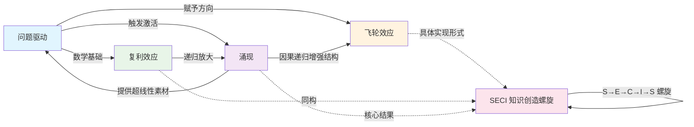

## 定义
> 问题驱动与涌现构成互为根基的螺旋上升结构——问题驱动为涌现提供触发条件和方向，涌现场质为下一轮问题驱动提供更丰富的素材，两者并非对立而是在每一轮循环中相互强化。

## 核心要点
1. 问题驱动与涌现互为根基，非对立关系
2. 二者构成螺旋上升结构，每轮循环提升系统认知层级
3. 问题驱动赋予方向，涌现赋予超越性，缺一不可

## 概念关系图

## 与相关概念的关系
- [[涌现理论]]：涌现是螺旋上升的核心结果；问题驱动提供触发条件，涌现产生全局新质
- [[飞轮效应]]：飞轮是螺旋上升的具体实现形式——因果递归增强结构推动系统跨越临界点
- [[复利效应]]：复利是螺旋上升的数学基础；每一轮利息成为下一轮本金，与螺旋上升同构
- [[SECI 知识创造螺旋]]：SECI 是螺旋上升在知识管理领域的具体实现；S→E→C→I→S 本身就是螺旋结构

## 关键案例/论据
- **Wiki 知识库的螺旋上升**：Query 触发概念页检索 → 跨页推理涌现新质 → 更丰富问题网络 → 下一轮更强涌现
- **SECI 螺旋的知识创造循环**：S→E→C→I→新S，向上螺旋

## 来源
### 对话文章：《2026-06-06 关于问题驱动与涌现的讨论》
- **参与者**：用户 / LLM
- **背景**：用户提问「问题驱动和涌现哪个更重要」，后补充「问题驱动和涌现是互为根基，并且是螺旋上升的」
- **核心对话摘录**：
  > 用户问："问题驱动 是问题驱动重要还是涌现重要？"
  > LLM 答："两者并非对立，而是相互构成的关系……问题驱动更重要——它是启动涌现的触发条件。但涌现最终更重要——当问题驱动积累突破临界点后，产生的全局新质是线性问题驱动无法企及的。"
  > 用户纠正："问题驱动 和 涌现的是互为基础，并且是螺线上升的。"
  > LLM 确认："螺旋上升是正确的表述。"
- **提炼出的要点**：
  1. 问题驱动与涌现互为根基，非对立关系
  2. 二者构成螺旋上升结构，每轮循环提升系统认知层级
  3. 问题驱动赋予方向，涌现赋予超越性，缺一不可
- **结论或共识**：螺旋上升是正确的表述，已固化为本概念页的核心定义
> 该对话文章被视为本次归档的原始材料，其内容已整合到本概念页中。