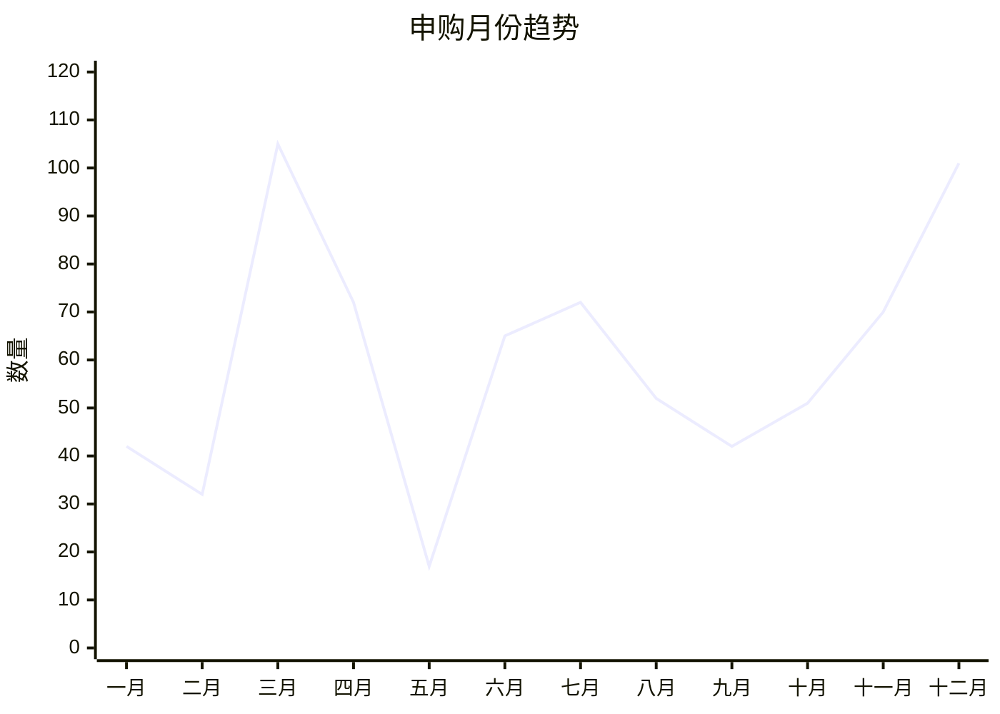
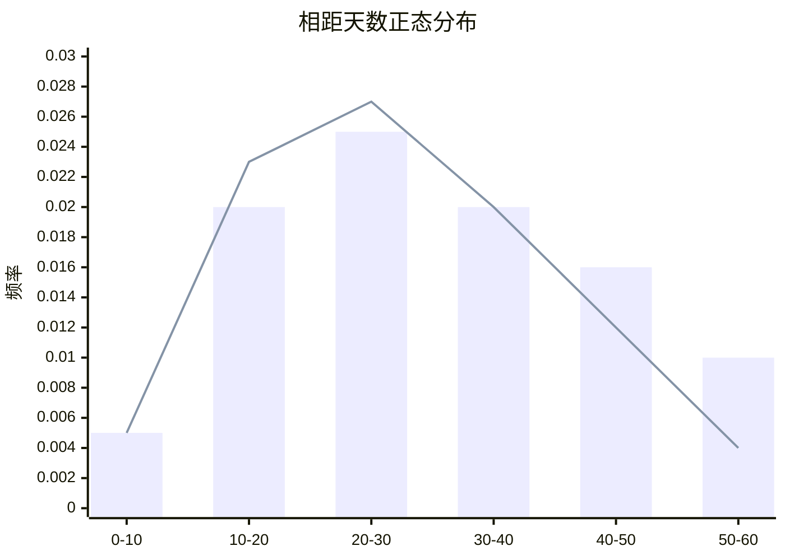

可转债潜伏时间
	月份节律：
		1月~2月:过年没有行情
		介入月份3月：年报更新之后，需要提交申请。所以赶在之前发行。
		4~5月：年报+分红分配方案之前不能发行+3月提前透支，所以没有行情。
		介入月份6~7月：淡季而有所反弹
		8~10月：6~7发行，之后进入低谷
		大介入月份11~12月：年底融资部门和券商的保荐都有业绩要求+,正股1月行情多所以发行的动力比较足
	同意注册后，发行时间的间隔时间：
		呈现左偏态正态分布，在30天为最高点
		原因：
			前期准备（制作正式文件、内部决策、路演与推介、交易所对接）15天左右
			财报有效期约为30天内
			等待高股价时发行，为了减少股价稀释
	潜伏策略：
		在2、3、6、7、11、12月份，举例同意注册之后20日找机会介入。

[[2026-09-09]]

