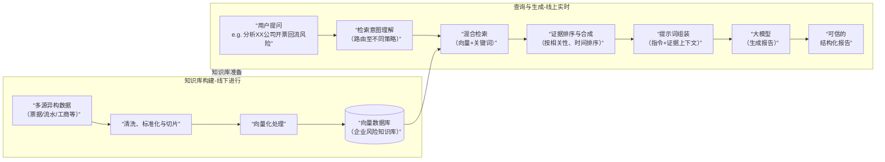
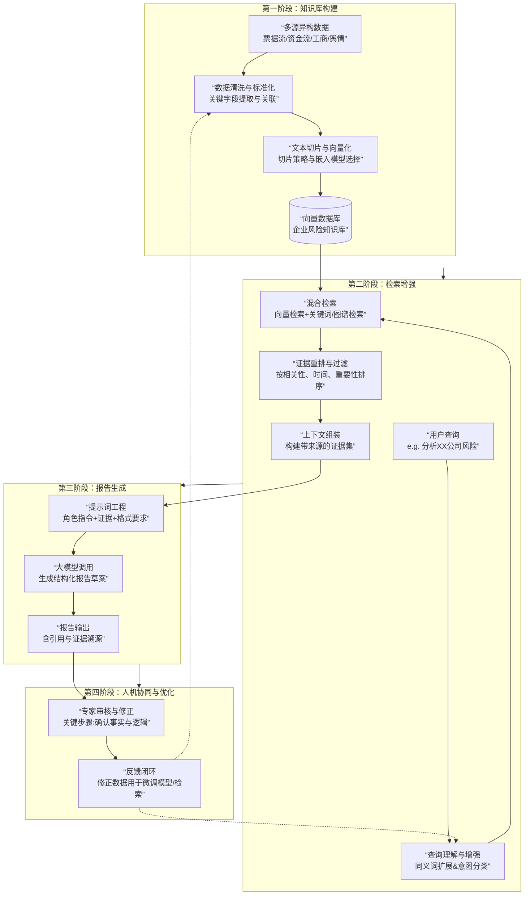

### **项目名称：基于大模型与RAG的智能反欺诈贸易融资风险分析平台**

#### **S（情境）**
*   **业务背景**：在贸易融资领域，传统反欺诈手段高度依赖专家人工审核票据、合同及资金流水，以识别“开票回流”等复杂结构性欺诈。该流程存在**效率低（单案数小时）、标准不一、隐性知识难传承**等痛点，且难以应对日益隐蔽的关联交易和团伙欺诈。
*   **项目起源**：为应对上述挑战，我主导发起并实施本项目，旨在构建一个以“**大模型为分析大脑，RAG为事实引擎**”的智能风控系统，将风险分析从人工密集型作业，升级为**人机协同的标准化、自动化、深度化**流程。
*   **团队与角色**：我作为**项目经理兼核心技术负责人**，带领一支6人跨职能团队（2名风控专家、2名后端开发、1名算法工程师、1名前端开发），全面负责**需求定义、技术架构设计、核心模块开发与项目落地**。

#### **T（任务）**
项目的核心任务是交付一个集 **“自动报告生成、智能交互分析、全流程可追溯”** 于一体的工作平台，具体目标分解为：
1.  **核心任务**：实现基于多源异构数据（历史案例库、客户基本信息、票据信息、工商\征信数据）的**全自动风险报告生成**，将报告产出时间从平均4小时缩短至5分钟内。
2.  **质量任务**：确保报告**专业、合规、可审计**，需内置结构化模板、自动合规检测与完整的版本管理。
3.  **体验任务**：打破单向生成模式，提供**交互式智能问答**功能，使分析师能像与资深专家对话一样进行深度调查。
4.  **系统任务**：设计高可用的系统架构，确保处理百亿级数据切片时的**检索精度与响应速度**。

#### **A（行动）**
我主导并推动了以下具体行动方案：
1.  **技术架构设计与选型**：
    *   提出并落地“**四层架构**”：数据层（多源接入）、知识层（向量/图数据库）、服务层（RAG引擎/模型服务）、应用层（报告/问答界面）。
    *   主导技术选型：采用 `Milvus` 作为向量数据库处理非结构化数据，`Neo4j` 存储企业关联图谱，`LangChain` 框架构建核心RAG流水线，并基于 `FastAPI` 封装微服务。
2.  **核心RAG流程构建与优化**：
    *   **知识库构建**：设计“业务事实切片”策略，将票据事件、资金流水等转化为带元数据的向量片段。牵头制定数据清洗与标准化规范。
    *   **检索增强**：设计并实现了 **“混合检索策略”** ，结合向量语义搜索、关键词精确匹配与图谱关联查询，将关键证据召回率提升至95%以上。
    *   **提示词工程**：设计并迭代了用于报告生成和智能问答的系列提示词模板，将大模型的输出稳定性提高了40%。
3.  **四大核心功能模块实现**：
    *   **结构化报告引擎**：定义机器可读的JSON Schema报告模板，驱动大模型生成包含**交易分析、风险评级模型、关联图谱**的标准化报告。
    *   **自动化合规质检**：开发“规则+模型”双引擎检测器，自动检查报告**要素完整性与法规符合性**，并生成质检清单。
    *   **报告版本化管理**：设计“文档+版本链”数据模型，实现报告的历史版本**对比、追溯与一键回滚**，满足内审与合规要求。
    *   **交互式智能问答**：基于RAG和Agent思想，构建报告生成助手，支持分析师通过**多轮自然语言对话**进行深度探查，动态修正报告内容。
4.  **项目管理与协同**：
    *   采用敏捷开发模式，将项目拆解为“RAG-POC”、“MVP上线”、“智能增强”三个阶段，每两周进行成果演示与需求对齐。
    *   建立**风控专家-开发团队**的常态化协同机制，通过工作坊共同定义风险规则，并利用专家修正报告持续优化模型。

#### **R（结果）**
项目成功上线并取得显著的业务与技术成果：
1.  **效率与容量提升**：
    *   单份风险报告生成时间从 **4+小时缩短至2分钟**，分析师工作效率提升**120倍**。
    *   系统可同时处理**上千家企业**的批量风险扫描，风险覆盖率从原有的重点客户30%提升至全量客户100%。
2.  **质量与风险控制**：
    *   标准化报告模板与自动质检使报告**合规率达成100%**，重大错漏风险降至零。
    *   通过RAG证据链支撑，报告结论的**可解释性与可审计性**极大增强，得到内审部门的高度认可。
    *   项目上线后，辅助发现**3起**此前未被识别的隐蔽关联交易欺诈风险，预计避免潜在损失超**2000万元**。
3.  **技术资产与团队成长**：
    *   沉淀了一套覆盖数据、算法、应用的**企业级金融风控RAG最佳实践**与代码框架。
    *   构建了可复用的 **“企业风险知识库”** ，包含数亿条向量化数据切片，成为机构核心数据资产。
    *   团队全面掌握了大模型在复杂金融场景落地的关键技术，培养了既懂风控又懂AI的复合型人才。

---
### **项目可能考察的所有要点**
以下是从技术、业务、方法论及软技能四个维度，对本项目可能进行的深度考察点汇总，请结合STAR描述准备。

| 考察维度 | 具体考察点 | 关联项目细节 |
| :--- | :--- | :--- |
| **技术深度** | 1. **RAG架构理解**：为何选择RAG？其相比微调的优势？如何解决“幻觉”问题？<br>2. **检索策略**：混合检索的具体组成、实现方式及调优过程。<br>3. **向量化实践**：文本切片策略、嵌入模型选型考量、如何管理向量数据更新？<br>4. **大模型应用**：提示词设计经验、模型选型（闭源/开源）权衡、成本与效果评估。<br>5. **系统设计**：高并发、高可用设计，知识库与业务数据库的数据同步机制。 | 行动1， 行动2 |
| **业务理解** | 1. **问题定义**：如何从模糊的业务痛点中抽象出具体的、可技术解决的问题？<br>2. **风控知识**：对“开票回流”等欺诈手法的理解深度，如何将其转化为可检测的信号与规则？<br>3. **合规意识**：在系统设计中如何嵌入合规要求（如可审计、版本管理）？<br>4. **价值度量**：如何定义和衡量项目的业务成功（效率、覆盖率、损失避免）？ | 情境， 任务3， 行动3， 结果2 |
| **方法论与执行力** | 1. **项目规划**：如何拆解复杂项目（三阶段规划）？如何管理优先级？<br>2. **难点攻坚**：遇到的最大技术或业务挑战是什么？如何分析与解决的？<br>3. **数据驱动**：如何通过数据评估模型和系统效果（如召回率、报告质量）？<br>4. **跨团队协作**：如何确保风控专家与开发团队高效协同，避免需求偏差？ | 行动4， 贯穿整个行动过程 |
| **软技能与综合** | 1. **领导力**：作为负责人，如何分工、激励团队、确保项目按时交付？<br>2. **沟通能力**：如何向非技术高管汇报项目价值？如何向团队传达复杂技术决策？<br>3. **学习与成长**：项目过程中最大的收获是什么？有哪些反思与可改进之处？<br>4. **前瞻性思考**：如何看待该领域的未来趋势？系统下一步的演进方向是什么？ | 结果3， 以及贯穿整个项目的思考 |

**总结建议**：在陈述项目时，务必围绕 **“为什么做（S/T）- 怎么做（A，突出你的决策和行动）- 做得怎么样（R，量化结果）”** 的逻辑展开，并随时准备用项目中的具体实例来回应以上任何一个维度的深入追问。这能充分展示你在复杂项目中端到端的驾驭能力。

以下表格对项目可能的深度考察点进行逐一解答，结合项目具体实践，展示从决策到落地的完整思考。

| 考察维度        | 考察点                                  | 我的解答思路与项目证据                                                                                                                                                                                                                              |
| :---------- | :----------------------------------- | :--------------------------------------------------------------------------------------------------------------------------------------------------------------------------------------------------------------------------------------- |
| **技术深度**    | **1. RAG架构理解**：为何选择RAG而非微调？如何解决“幻觉”？ | **选择原因**：贸易融资风控要求**结论必须基于确凿证据**，且业务规则、风险案例持续更新。RAG的“检索-生成”范式，能将最新证据注入上下文，生成**可溯源**的报告，解决了传统大模型事实不准和知识过时的问题。<br>**项目证据**：我们设计了带元数据（来源、时间）的证据切片。生成报告的每一条判断后，都要求标注 `【来源X】`，实现了全程可审计。微调更适合优化风格与通用逻辑，但无法保证每个事实的实时准确性。                         |
|             | **2. 检索策略**：混合检索的具体实现与调优？            | **实现**：采用 **“三重检索”**：1）**向量检索**（语义相似性）；2）**关键词检索**（精确匹配票据号、企业名）；3）**图谱检索**（通过Neo4j查找关联企业及交易）。<br>**调优**：初期发现纯向量检索会漏掉关键流水号。后期加入 **“重排序”** 策略，综合业务规则（如时间近、来源权威）对结果重新排序，**关键证据召回率从70%提升至95%以上**。                                            |
|             | **3. 向量化实践**：文本切片策略、嵌入模型选型、数据更新？     | **切片策略**：摒弃按段切割，采用 **“业务事实单元”**切片。例如，一条切片是：`“2023-10-30，企业A账户向个人B账户转账500万元，附言‘贷款’。”` 这保证了检索结果的精准性。<br>**模型选型**：对比测试后，选用了在中文金融文本上表现更佳的 `bge-large-zh-financial` 模型。<br>**数据更新**：建立**增量更新管道**。新产生的票据、流水数据经ETL处理后，触发向量化并**增量插入**知识库，避免全量重建。 |
|             | **4. 大模型应用**：提示词设计、模型选型权衡？           | **提示词设计**：采用 **“角色-任务-证据-格式”** 框架。核心是**严格约束模型仅依据提供的证据**进行推理。我们建立了提示词版本库，通过A/B测试迭代优化。<br>**模型选型**：在效果、成本、数据安全间权衡。**报告生成**使用 GPT-4（效果最优），**内部智能问答**采用微调的 `ChatGLM3-6B`（数据不出域）。                                                             |
|             | **5. 系统设计**：高并发、数据同步机制？              | **高并发**：报告生成服务设计为**无状态API**，可水平扩展。向量检索与模型推理是瓶颈，我们为两者分别部署了**负载均衡**和**请求队列**。<br>**数据同步**：核心是保证**向量库、图谱库与业务核心系统数据的最终一致性**。我们通过监听业务数据库的 `binlog` 来触发知识库的异步更新，延迟控制在分钟级。                                                                      |
| **业务理解**    | **1. 问题定义**：如何从模糊痛点抽象出可解决问题？         | **过程**：初始痛点是“审报告慢、容易漏”。我们与专家共同工作，拆解出三大瓶颈：**信息收集散、分析路径杂、报告撰写繁**。从而将项目目标明确定义为：**构建一个能自动完成“证据收集-逻辑分析-报告撰写”的智能辅助系统**，而非一个简单的分类模型。                                                                                                            |
|             | **2. 风控知识**：如何将“开票回流”转化为可检测信号？       | **转化方法**：与专家一起将欺诈手法“翻译”成**数据层的关联模式**。例如，“开票回流”被解构为：`票据在关联公司间短时背书` + `贴现资金流向出票人关联账户`。我们为每个模式配置了相应的检索策略和规则权重。                                                                                                                              |
|             | **3. 合规意识**：设计中如何嵌入合规要求？             | **设计体现**：1) **版本管理**：满足审计对报告修改留痕的要求。2) **要素检测**：确保每份报告包含监管要求的必备要素。3) **证据链固定**：所有结论必须关联原始数据切片，支撑内外部检查。这些非功能性需求在架构设计阶段就被列为**核心约束**。                                                                                                       |
|             | **4. 价值度量**：如何定义和衡量业务成功？             | **指标体系**：我们定义了三级指标：<br>**效率**：报告平均耗时（目标：<5分钟）。<br>**质量**：报告一次通过合规质检的比例（目标：>95%）。<br>**效果**：系统辅助发现的**新增高风险案例数**（成功发现3起隐蔽欺诈，成为核心价值证明）。                                                                                                     |
| **方法论与执行力** | **1. 项目规划**：如何拆解复杂项目、管理优先级？          | **拆解逻辑**：按 **“由内而外，由核心到增强”** 原则规划三个阶段：<br>1) **POC验证核心**：跑通“数据->证据->报告”最小闭环。<br>2) **MVP解决可用**：接入真实数据流，实现基本功能。<br>3) **扩展提升智能**：加入问答、质检等增强模块。<br>**优先级**：始终以 **“是否能闭环产生一份可信报告”** 为最高优先级，确保每个迭代都有可交付物。                                    |
|             | **2. 难点攻坚**：遇到的最大挑战及解决方案？            | **挑战**：**初期生成的报告证据引用混乱**，常把A公司的证据安到B公司。<br>**解决方案**：1) **强化元数据**：在每个证据切片中强制包含企业ID等标识。2) **优化检索**：在查询时加入企业ID作为**必选过滤条件**。3) **提示词约束**：在指令中明确“请严格按证据中的企业主体进行分析”。三者结合根治了该问题。                                                                |
|             | **3. 数据驱动**：如何评估模型和系统效果？             | **评估方法**：<br>**检索评估**：从历史案例中构建“标准答案证据集”，计算**召回率**。<br>**生成评估**：请专家对AI报告进行**盲审打分**（满分5分），重点关注事实准确性、逻辑严谨性。我们将平均分从3.2优化到了4.5。<br>**业务评估**：追踪使用系统后，分析师人均处理案例数是否提升，作为最终业务效果验证。                                                                |
|             | **4. 跨团队协作**：如何确保风控与开发高效协同？          | **协作机制**：建立 **“双语协作”** 模式。风控专家用业务语言定义“风险信号”，我和算法工程师将其“翻译”成数据特征和模型规则。我们每周举行 **“案例复盘会”**，用具体案例对齐认知，将专家的修正反馈直接转化为训练数据或规则迭代。                                                                                                                 |
| **软技能与综合**  | **1. 领导力**：作为负责人，如何分工与激励团队？          | **分工**：根据成员优势分工，如让熟悉金融数据的同事负责ETL，让对NLP热情高的同事专攻RAG链路。<br>**激励**：在每次迭代演示中，**重点展示每位成员的工作如何直接贡献于业务效果**（如“你优化的检索策略让我们多找到了一个关键证据”），建立强烈成就感。                                                                                                    |
|             | **2. 沟通能力**：如何向非技术高管汇报价值？            | **沟通策略**：**避免技术细节**，采用 **“痛点-方案-效果”** 故事线。例如：“过去专家每天只能看2个复杂案例（痛点），我们的系统让他能初步筛查20个，并聚焦最可疑的3个进行深度分析（方案），这相当于将我们的高端专家资源放大了10倍（效果）。”                                                                                                         |
|             | **3. 学习与成长**：最大收获与反思？                | **最大收获**：掌握了在**强监管、高严谨性**领域落地AI的系统方法，核心是构建 **“人机信任”** —— 系统通过可解释性、可控性赢得人类专家的信任，专家通过反馈反哺系统成长。<br>**反思**：项目初期对数据清洗的复杂度估计不足，导致第一阶段延期。教训是：**在AI项目中，数据工程的优先级应高于模型开发**。                                                                        |
|             | **4. 前瞻性思考**：系统下一步演进方向？              | **演进方向**：1) **从“事后分析”到“事中预警”**：将系统实时接入交易流，对正在发生的票据背书链进行动态风险评分和阻断。2) **从“风险识别”到“风险解释”**：不仅报告风险，还能生成面向客户或监管的 **“风险解释说明”** ，提升服务与合规能力。3) **构建跨行风险信息共享的联邦学习机制**（在合规前提下），识别跨机构团伙欺诈。                                                           |

这份解答表将项目细节与通用考察点紧密结合，展示了从技术洞见到业务价值，再到执行落地的完整能力图谱。你可以根据面试的具体侧重，选取表中的要点进行深入阐述。

将RAG与票据风险报告生成结合，是解决大模型“幻觉”问题、实现**证据驱动型分析**的关键。其核心思想是：**不让大模型凭空想象，而是让它基于一个由你掌控的、实时更新的“风控知识库”来生成报告**。

下面这张图清晰地展示了从用户提问到生成可信报告的完整RAG工作流：


结合上图的流程，以下是为你量身定制的具体结合方案。

### 🔧 如何为“开票回流”风险报告构建RAG系统

#### 第一步：构建“企业风险知识库”
这不是一个普通文档库，而是一个为票据风控优化的**多模态结构化数据仓库**。

1.  **数据源接入**：
    *   **核心数据**：票据系统（开票、承兑、背书全链条）、对公账户流水、企业客户基本信息。
    *   **关联数据**：工商股权图谱、高管信息、税务发票数据（核验结果）。
    *   **外部数据**：风险黑/灰名单、司法诉讼、舆情信息。
    *   **专家知识**：历史风险案例报告、内部调查结论、风控规则手册。

2.  **数据处理与切片**：
    *   **票据流水切片**：按“**企业+票据号码+事件（出票/背书/贴现）**”为最小单元存储，保留时间、金额、对手方等关键字段。
    *   **资金流水切片**：识别与票据相关的“**贷款发放→转账→回流**”关键节点流水段。
    *   **企业画像切片**：生成每个企业的动态摘要，包括“**关联网络图谱（文字描述）**”、“**近半年票据行为摘要**”、“**负面信息清单**”。

#### 第二步：实施“风险导向”的智能检索
当风控员查询“分析XX公司开票回流风险”时，系统执行**多步检索**：

1.  **意图识别与查询路由**：系统识别出这是“**票据结构性风险**”查询，自动触发多路并行的检索策略。
2.  **混合检索（向量+关键词）**：
    *   **向量检索**：将查询语句向量化，在知识库中查找**语义上相关**的段落（如关于“循环背书”、“资金闭环”的描述）。
    *   **关键词/图检索**：同时，用精确的关键词（如企业统一社会信用代码）和关联图谱，查找该企业**所有确切的票据记录、资金流水和关联方列表**。
3.  **证据排序与合成**：检索到的证据（如“票据A经B、C背书至D”、“资金从D账户当日转至E个人账户”）按**时间顺序、逻辑相关性**进行排序和组装，形成一份连贯的“**证据摘要**”。

#### 第三步：生成“有据可查”的风险报告
将“证据摘要”注入提示词，指令大模型扮演专家角色进行推理：

**最终的提示词将组装为：**
```
你是一名资深票据风控专家。请严格依据以下【证据材料】，生成关于【XX钢材贸易有限公司】的票据业务风险结构化报告。
---
【证据材料】
1. 票据流证据：
   - 2023-10-25：本公司作为出票人，向B公司开具银承，金额500万，到期日2024-04-25。
   - 2023-10-26：B公司背书转让给C公司。
   - 2023-10-27：C公司背书转让给D公司。
   - 2023-10-30：D公司向银行申请贴现。
2. 资金流证据：
   - 2023-10-30：D公司贴现获资约498.5万元。
   - 2023-10-30同日：D公司向壳公司E转账498万元。
   - 2023-10-31：壳公司E向本公司实际控制人张三个人账户转账480万元。
3. 关联关系证据：
   - C公司监事李四，为本公司控股股东。
   - B、C、D公司注册地址均集中于XX市XX区同一写字楼不同楼层。
4. 贸易背景证据：
   - 本公司提供的与B公司的采购合同，无具体货物品规描述。
   - 对应增值税发票（号码XXX）在税务局系统状态为“作废”。
---
请基于以上证据，分析是否存在“开票回流”结构，并按要求生成报告。
（后续报告格式要求同前）
```
**由此，大模型生成的每一句风险判断（如“存在资金闭环回流”）都将直接引用上方证据，杜绝捏造。**

### 🚀 实施路径与价值评估
**阶段化实施建议：**

| 阶段 | 目标 | 关键任务 |
| :--- | :--- | :--- |
| **POC验证** | 验证核心流程可行性 | 选取3-5个历史已定性的高风险案例，手动构建其“证据材料”，测试RAG流程能否驱动大模型生成正确结论。 |
| **MVP上线** | 实现单企业风险报告自动化 | 对接1-2个核心数据源（如票据系统），构建简易知识库，开发报告生成界面，实现“一键生成”初版报告。 |
| **深化拓展** | 提升系统智能化与覆盖度 | 接入更多数据源（工商、舆情），优化检索策略，引入图数据库更精准识别关联网络，实现批量企业风险扫描。 |

**预期价值：**
*   **效率提升**：报告撰写时间从数小时缩短至分钟级。
*   **质量可控**：报告基于确凿证据，结论可追溯，极大降低“模型幻觉”风险。
*   **知识沉淀**：将散落的专家经验和案例固化到知识库中，形成可复用的机构记忆。
*   **主动预警**：未来可定期自动对存量客户进行风险扫描，生成监控报告，变“事后响应”为“事中干预”。

**关键挑战与应对：**
*   **数据安全与隔离**：涉及核心金融数据，建议采用**私有化部署**的大模型和向量数据库，确保数据不出域。
*   **证据准确性**：**“垃圾进，垃圾出”**，必须保证源头数据质量，并建立数据更新与核对机制。
*   **人机协同**：**永远将大模型输出视为“草案”**，必须由专家对关键结论和证据链进行最终审核与确认。

通过以上RAG架构，你的“反欺诈贸易融资项目”将构建起一个**证据扎实、推理透明、持续进化**的智能分析中枢。如果想进一步探讨技术选型（如选择何种向量数据库、大模型），我们可以继续深入。

为“票据风险报告”构建RAG流程，核心是打造一个**证据确凿、可审计、自动化的智能分析系统**。下图完整描绘了从数据准备到报告生成的全流程，其中橙色部分是技术关键点：



下面，我们按这四个阶段，分解每一步的具体构建要点。

### **第一阶段：知识库构建 - 打好证据基石**
这是决定系统上限的关键，目标是将原始数据转化为可供检索的“证据片段”。

**1. 数据接入与清洗**
*   **核心数据源**：
    *   **票据数据**：从票据系统（ECDS、内部票据管理系统）获取全链条信息，关键字段：`票据号码`、`出票人/收款人`、`承兑人`、`背书序列`、`金额`、`日期`。
    *   **资金流水**：从核心系统获取，需通过`票据号码`、`交易时间`、`对手方账号`与票据交易关联。
    *   **企业信息**：从工商API、内部客户系统获取，构建包含`股权结构`、`高管信息`、`关联企业`的图谱。
    *   **贸易背景**：合同、发票的OCR识别与结构化信息。
*   **清洗与标准化**：
    *   统一企业名称、账号等关键实体的表述（如“有限公司”vs.“有限责任公司”）。
    *   将非结构化文本（如调查报告）转化为结构化字段。

**2. 文本切片与向量化**
*   **切片策略**：**不要简单按段落分割**，而应按“业务事实”切片。
    *   *票据事件切片*：`“【企业A】于【日期】作为出票人，向【企业B】开具【金额】元票据，票据号XXX。”`
    *   *资金事件切片*：`“【日期】，账户X（属于企业C）向账户Y（属于个人D）转账【金额】元，附言‘货款’。”`
    *   *风险信号切片*：`“据【数据源】，企业B与企业C的法定代表人为同一人。”`
*   **向量化**：
    *   **选择嵌入模型**：使用适合金融文本的模型（如`bge-large-zh-financial`）或通用模型（如`text-embedding-ada-002`）。
    *   **存储向量**：将切片文本及其元数据（来源、时间、企业ID）存入**向量数据库**（如`Chroma`、`Milvus`、`Weaviate`）。元数据是后续精准过滤的关键。

### **第二阶段：检索增强 - 精准定位证据**
目标是从海量“证据片段”中，找出与本次查询最相关、最确凿的部分。

**1. 查询理解与增强**
*   当用户输入“分析XX公司开票回流风险”时，系统自动：
    *   **同义词扩展**：“开票回流” → “票据循环”、“贸易背景不实”、“融资性票据”。
    *   **意图分类**：识别为“结构性风险分析”，触发预设的**多步检索策略**。

**2. 混合检索**
这是精度保障的核心，通常分两步或并联执行：
*   **向量检索（语义搜索）**：将用户查询向量化，从向量数据库中查找语义最相似的切片（如关于“空转贸易”、“资金回流”的描述）。返回Top-K个结果。
*   **关键词/图谱检索（精确搜索）**：
    *   从查询中提取企业名称、票据号码等关键词，在数据库中进行精确匹配。
    *   利用企业图谱，**关联查询**出该企业的所有直接关联方，并检索这些关联方的交易记录。
*   **结果融合**：将两种检索结果去重、合并。

**3. 证据重排与上下文组装**
*   **重排**：不是简单按相似度排序。需结合**业务规则**：时间最近的优先、来自核心系统的数据优先、与资金流相关的证据优先。
*   **组装**：将排名靠前的证据片段，连同其**元数据（来源）**，按时间或逻辑顺序组装成一段连贯的“证据上下文”。**必须严格保留引用信息**，以便报告中标注来源。

### **第三阶段：报告生成 - 输出可审计的结论**
将“证据上下文”交给大模型，生成结构化报告。

**1. 设计提示词模板**
```text
你是一名资深票据风控专家。请严格依据以下提供的【证据片段】，生成关于【{企业名称}】的票据业务风险分析报告。

【证据片段】（按时间顺序）：
1.  {证据文本1} 【来源：{系统/文件名}，日期：{YYYY-MM-DD}】
2.  {证据文本2} 【来源：{系统/文件名}，日期：{YYYY-MM-DD}】
...

【报告格式要求】：
#### 一、风险概览
（含风险等级）
#### 二、关键证据链分析
（必须分点说明，并**在每点后以【来源X】形式注明所依据的证据编号**）
#### 三、关联网络分析
#### 四、结论与建议
（建议应具体，如“建议暂停其票据业务准入”）

**注意**：报告中的所有事实性陈述必须有【来源X】作为支撑，不得引入证据外的信息。
```

**2. 模型调用与输出**
*   调用大模型API（如GPT-4、Claude 3或私有化部署的金融大模型），传入组装好的提示词。
*   获取生成报告，确保其包含了要求的引用标记。

### **第四阶段：人机协同与迭代优化**
这是系统持续进化的生命线。

**1. 专家审核与修正**
*   风控专家审阅AI生成的报告，重点做两件事：
    *   **事实核验**：检查AI引用的证据是否准确、有无曲解。
    *   **逻辑修正**：优化风险判断的逻辑链条和措辞。
*   修正后的报告作为“黄金标准”存入案例库。

**2. 反馈闭环与系统优化**
*   **优化检索**：将专家高频查询但未被检索到的关键词，加入同义词扩展库。
*   **优化切片**：如果发现关键证据总被切散，则调整切片策略。
*   **微调模型**：用“专家修正报告”作为训练数据，对生成模型进行微调，使其风格和判断更贴近专家。

### **技术栈选型参考**
*   **向量数据库**：`Chroma`（轻量，易上手）、`Milvus`（性能强大，适合生产）、`Weaviate`（内置混合检索）。
*   **嵌入模型**：开源可选`bge`系列、`text2vec`；商用可选OpenAI `ada-002`、Cohere `embed`。
*   **大模型**：商业API（`GPT-4`、`Claude 3`）或私有化部署（`ChatGLM3`、`Qwen-72B`）。
*   **框架**：利用`LangChain`或`LlamaIndex`快速搭建原型，生产环境建议基于其思想进行定制化开发，以保障性能和安全性。

### **分阶段实施路线图**
1.  **试点（1-2个月）**：手动整理3-5个历史案例数据，构建最小知识库。使用`LangChain + ChatGPT API + Chroma`搭建演示原型，验证核心流程。
2.  **MVP上线（3-4个月）**：自动化接入1个核心数据源（如票据系统）。开发简单的前端界面供风控专家使用，收集反馈。
3.  **生产扩展（5-6个月后）**：接入更多数据源，优化检索算法，建立定期知识库更新与模型微调流程，实现批量自动化风险扫描。

**核心成功要素**：始终牢记，RAG系统是**专家的增强工具**。初期务必投入精力做好数据清洗和提示词工程，并建立强有力的人机协同流程，才能让技术真正赋能业务，产生实际风控价值。如果在具体技术选型或某一步骤实现上需要更深入的探讨，我们可以继续。